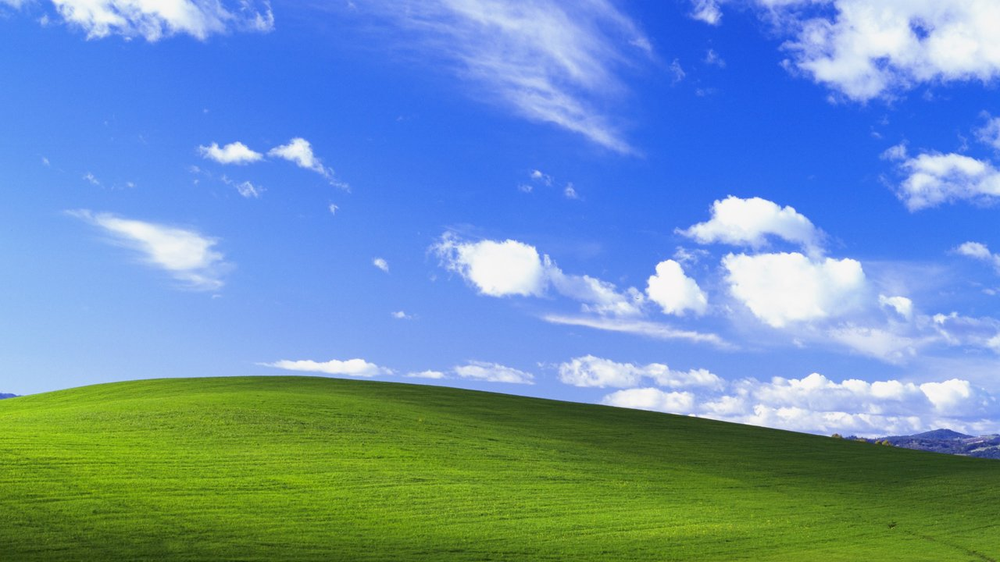

<div align="center">


# Windows XP for Omarchy

**Luna blue. Bliss green. A familiar Start button.**

Bring the Windows XP look to Omarchy with a complete desktop theme,
classic icons and cursors, an XP taskbar, and a black CMD-style terminal.

[](https://omarchy.org/)
[](#whats-inside)
[](https://github.com/0xyg3n/omarchy-windows-xp/releases/latest)

[Get started](#installation) · [CMD colors](#the-terminal) · [Privacy](#privacy) · [Credits](#credits)



<sub>The included Bliss wallpaper. Desktop appearance depends on your Omarchy version and installed applications.</sub>

</div>

## What's inside

| Component | What you get |
| --- | --- |
| **Desktop** | Bliss wallpaper, Luna blue accents, beige surfaces, square window corners, and desktop shortcuts. |
| **Start menu** | XP-style Start button and two-column menu with familiar icons. |
| **Taskbar** | Quick Launch, task buttons for open windows, notification area, volume shortcut, and clock. |
| **Applications** | Windows XP Luna styling, GTK appearance settings, and generated application color themes. |
| **Icons & cursors** | The complete Windows XP icon pack and Chicago95 standard cursors. |
| **Terminals** | A pure black background, silver text, and the classic 16-color CMD palette. |
| **Configuration** | Four Quickshell plugins, a theme-switch hook, and a reference bar layout. |

## Installation

### 1. Check compatibility

This bundle targets Omarchy installations using **Lua Hyprland configuration**
and the **Quickshell plugin interfaces** used by the included plugins.

- Install **Liberation Sans** and your preferred monospace font; fonts are not bundled.
- GTK 2 applications may need the **Murrine** theme engine.
- Optional applications named in the Start menu must be installed separately.

This is a complete desktop bundle with additional assets and plugins. Use the
manual installation below; the repository layout is not intended for
`omarchy theme install`.

### 2. Download the bundle

```sh
git clone https://github.com/0xyg3n/omarchy-windows-xp.git
cd omarchy-windows-xp
```

Prefer a ZIP? Download **windows-xp-omarchy.zip** from the
[latest release](https://github.com/0xyg3n/omarchy-windows-xp/releases/latest),
extract it, and open a terminal inside the extracted directory.

### 3. Back up matching settings, then copy

Back up existing files in the corresponding theme, plugin, icon, cursor, and GTK
configuration locations before copying. The GTK files replace appearance
settings. The theme hook changes the bar layout when switching themes.

```sh
cp -a home/. "$HOME/"
chmod +x "$HOME/.config/omarchy/hooks/theme-set.d/xp-chrome.sh"
```

### 4. Apply Windows XP

```sh
omarchy theme set windows-xp
```

The hook configures the XP bar, fonts, GTK styling, icons, cursors, and terminal
colors. Open a **new terminal window** after applying the theme.

<details>
<summary><strong>Where the files go</strong></summary>

```text
home/
├── .config/
│   ├── gtk-3.0/settings.ini
│   ├── gtk-4.0/settings.ini
│   └── omarchy/
│       ├── themes/windows-xp/
│       ├── plugins/
│       │   ├── xp.start/
│       │   ├── xp.launch/
│       │   ├── xp.tasks/
│       │   └── xp.notify/
│       └── hooks/theme-set.d/xp-chrome.sh
├── .local/share/icons/
│   ├── Windows XP/
│   └── Chicago95_Standard_Cursors/
└── .themes/Windows XP Luna/
```

`shell-config.example.json` contains only the XP bar layout. Merge its `bar`
object if needed instead of replacing personal shell settings. Asset directories
contain real files, so there are no links back to the original machine.

</details>

## The terminal

Think classic Command Prompt: **black background, silver text, standard CMD
colors**. Matching configurations are included for **Foot, Alacritty, Kitty,
and Ghostty**.

| Setting | Color |
| --- | --- |
| Background | `#000000` |
| Text | `#C0C0C0` |
| Cursor | `#C0C0C0` |
| Palette | Classic 16-color CMD palette |

The XP theme applies these colors automatically. To keep them when using other
desktop themes, merge the matching file from `terminal-overrides/` into your
terminal configuration, avoiding duplicate TOML or INI sections. Then run:

```sh
omarchy restart terminal
```

**Using Foot?** Existing windows keep their in-memory configuration. Open a new
window to load the installed colors; your existing sessions can stay open.

## Verify your download

From the extracted bundle or repository root:

```sh
sha256sum -c SHA256SUMS
```

The manifest covers the exported theme bundle. Repository documentation is
maintained separately. Releases also include a checksum for the ZIP itself.

## Privacy

The bundle was prepared from an explicitly selected set of theme files and
published with a **fresh Git history**.

- Unrelated configuration, account data, credentials, browser profiles, shell history, logs, caches, and backups are excluded.
- Local usernames and author fields were removed from the custom plugins.
- Image text and EXIF metadata were removed; internal asset links were materialized.
- Commits use a GitHub no-reply email address.

The checks found no private data. See [PRIVACY-CHECK.txt](PRIVACY-CHECK.txt) for
the checks and their limits.

## Credits

Built from the installed custom Omarchy XP theme and these upstream assets:

| Asset | Upstream |
| --- | --- |
| Windows XP icons | [B00merang Artwork / Windows-XP](https://github.com/B00merang-Artwork/Windows-XP) |
| Windows XP Luna application theme | [B00merang Project / Windows-XP](https://github.com/B00merang-Project/Windows-XP) |
| Chicago95 cursors | [grassmunk / Chicago95](https://github.com/grassmunk/Chicago95) |
| Bliss wallpaper | Charles O'Rear |

Supplied license and credit files are retained in [`licenses/`](licenses/) and
the asset directories. Windows artwork and marks belong to their respective
owners; this bundle does not grant a new blanket license for third-party assets.

---

<div align="center">
<sub>Start here. Feel at home.</sub>
</div>
